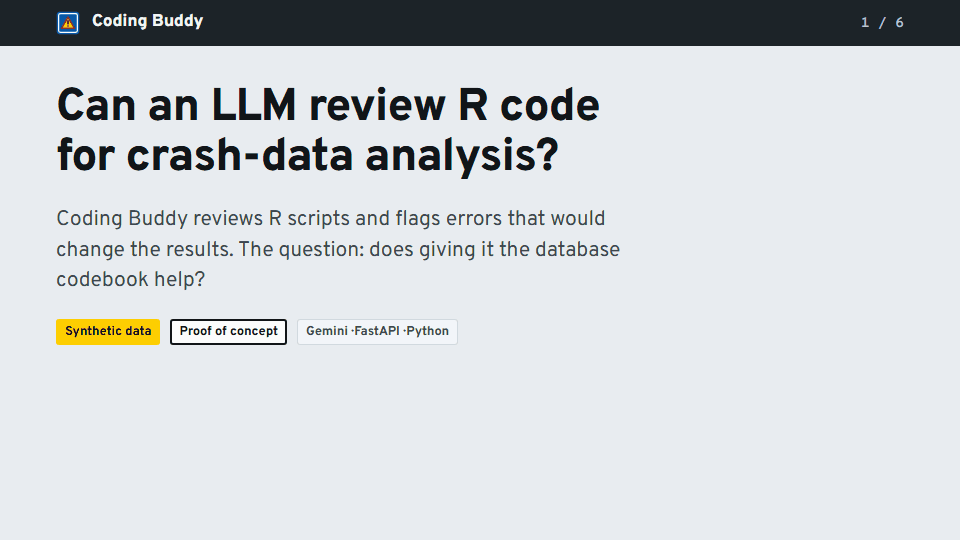

# Coding Buddy

**An LLM reviewer for R code used in traffic-safety crash-data analysis, and a small benchmark that
measures whether giving it the database codebook helps.**



> Proof of concept for a master-thesis discussion. All data, scripts and the codebook are
> **synthetic**. The numbers below come from one small experiment, not a finished result.

## What it does

Crash-data analyses are mostly written in R, and a quiet error such as a wrong join key, a filter
that drops valid rows or an "unknown" code treated as a value changes the result without any error
message. Coding Buddy asks an LLM to review a script and report only errors that would change the
analysis, each pinned to a line with an explanation.

The research question behind it: **does domain knowledge help the reviewer?** Every script is
reviewed twice, once with the code alone and once with the database codebook in the prompt (a
minimal retrieval-augmented, or RAG, setting). Each review is scored against known, injected errors.

## Result

`gemini-3.1-flash-lite`, temperature 0, 1 run per condition:

| Condition | Errors located | Right cause named | False alarms |
|---|---|---|---|
| Code only | 6 / 6 | **3 / 6** | 1 |
| Code + codebook | 6 / 6 | **6 / 6** | 1 |

Both conditions point at the right line every time. The difference is the diagnosis. Without the
codebook the model blamed `NA` handling instead of the unknown code `9`, and it invented column
names (`veh_id`, `person_weight`) that would not fix the script. With the codebook it named the
real variable, code or rule in all six cases. The full breakdown is in
[`results/report.md`](results/report.md), and every raw finding is in
[`results/results.json`](results/results.json).

## How it works



1. **Benchmark.** [`benchmark/scripts/`](benchmark/scripts) holds 8 short analyses on a synthetic
   in-depth crash database (crashes, vehicles, occupants), described in
   [`benchmark/codebook.md`](benchmark/codebook.md). Six scripts contain exactly one injected error:

   | Script | Injected error | Needs the codebook to spot? |
   |---|---|---|
   | 01 | Occupants joined to vehicles on `crash_id` only | no |
   | 02 | Study period 2015–2022 filtered with strict inequalities | no |
   | 03 | `delta_v` is already km/h but is converted as if mph | yes |
   | 04 | Weighted by `vehicle_weight` (kg) instead of `case_weight` | yes |
   | 05 | `belt_use = 9` (unknown) averaged as a value | yes |
   | 06 | Uncoded injuries recoded as uninjured | no |

   [`benchmark/manifest.json`](benchmark/manifest.json) records the injected line and the keywords a
   correct diagnosis must contain.
2. **Review.** Each script is sent with numbered lines to Gemini, with and without the codebook. A
   JSON response schema forces structured findings (`line`, `category`, `explanation`) at
   temperature 0.
3. **Scoring.** Each finding is compared with the ground truth:
   - **Located:** it points within ±2 lines of the injected error.
   - **Right cause:** it is located and its explanation names the real cause. For bugs about a
     variable, the real variable name is required, because an invented column would not fix the script.
   - **False alarm:** any other finding, including on the clean scripts. This is strict, since a
     correct remark about an issue that was not injected also counts.
4. **Report and UI.** Results are written to `results/` and can be rescored without new API calls.
   The demo UI reads them from a small FastAPI server.

## Demo UI

A local web app built for screen-sharing:

- **Benchmark:** the headline comparison, every script with its per-condition status, and the
  code with the model's findings drawn as warning signs on the exact lines. *Compare* shows both
  conditions on the same lines.
- **Live review:** paste any R script and review it with or without the codebook (`Ctrl+Enter`).
- **Codebook:** the domain notes the model receives.
- **Slides:** a six-slide explainer at `/static/explainer.html` (arrow keys or click to advance).

Deep links: `/?script=05&mode=compare` opens a script directly.

## Run it

Requires Python 3.12+ and [uv](https://docs.astral.sh/uv/).

```bash
uv sync
```

Create `.env` (git-ignored) with a Gemini API key:

```
GEMINI_API_KEY=...
```

Start the UI, then open http://127.0.0.1:8000:

```bash
uv run coding-buddy-ui
```

Run the benchmark (16 API calls per repeat):

```bash
uv run coding-buddy --model gemini-3.1-flash-lite --repeats 1
```

Rescore saved findings after changing the ground truth (no API calls):

```bash
uv run coding-buddy --rescore
```

Run the tests (offline, with fake reviewers):

```bash
uv run pytest
```

Optional: generate the synthetic CSVs so the R scripts can be run in R:

```bash
uv run python benchmark/generate_data.py
```

Live review uses `gemini-3.5-flash-lite` by default; set `CODING_BUDDY_MODEL` to change it. The
Gemini free tier allows about 20 requests per model per day, so `--repeats 3` needs a paid key or
several days.

## Project layout

| Path | What it is |
|---|---|
| `benchmark/` | Codebook, R scripts, ground-truth manifest, synthetic data generator |
| `src/coding_buddy/reviewer.py` | Prompt construction and the Gemini reviewer |
| `src/coding_buddy/scoring.py` | Located / right cause / false alarm scoring |
| `src/coding_buddy/runner.py` | Runs both conditions; saves and rescores results |
| `src/coding_buddy/report.py` | One-page Markdown report |
| `src/coding_buddy/web/` | FastAPI app and the HTML/CSS/JS front end |
| `results/` | `report.md` and `results.json` from the latest run |
| `tests/` | Offline tests for scoring, reporting and the API |

## Limits and next steps

- Synthetic data and codebook, 8 scripts, one model, one run. This is a smoke test of the idea.
- Keyword-based "right cause" scoring is transparent but crude, and the keyword list for script 04 was
  tightened after the first run (documented in the manifest). Expert judgment should replace it.
- Next steps: real analysis scripts and codebooks, more error types, several models, retrieval of only
  the relevant codebook sections, and review of the explanations by domain experts.

**Stack:** Python 3.12, Google Gemini (`google-genai`), FastAPI, Pydantic, plain HTML/CSS/JS, pytest, uv.
